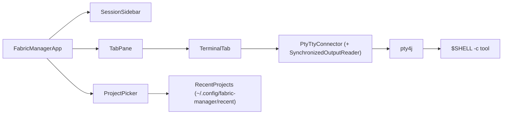

# FabricManager

Tabbed JavaFX terminal for Claude Code, Codex, Gemini, Aider or any CLI. Java 21, JavaFX 21,
[JediTermFX](https://github.com/techsenger/jeditermfx) 1.1.0 (JavaFX Canvas port of JetBrains JediTerm),
[pty4j](https://github.com/JetBrains/pty4j) 0.14.0.

```bash
./run.sh              # builds (incremental), opens the main window (no tab yet; use the sidebar or shortcuts)
./run.sh ~/proj       # opens ~/proj directly with the last used tool
```

| Key | Action |
|---|---|
| Ctrl+Shift+N | project picker (folder + tool) |
| Ctrl+Shift+T | new shell tab in the current directory |
| Ctrl+Shift+W | close tab |
| Ctrl+Shift+D | split: shell beside the session (again = switch orientation) |
| Ctrl+Shift+[ / Ctrl+Shift+] | move focus between the two panes of a split tab (clicking a pane works too) |
| Ctrl+Shift+H | git history of the current tab's repository |
| Ctrl+Shift+, | Settings: General, Terminal, Notifications, Accounts, Body double, Claude Code (changes save at once; Esc clears the search, Esc again closes; the Claude Code group opens the config browser for CLAUDE.md, settings, skills, agents…) |
| Ctrl+Shift+S | snippets: fuzzy picker, types the chosen snippet into the active terminal |
| Ctrl+Shift+J | notes |
| Ctrl+Shift+K | tasks: notes with an optional due date (Overdue / Today / Later / No date) |
| Ctrl+Shift+P | processes: all Docker containers and your Java / Node (Angular) processes; start, stop, logs; a stats bar on top shows CPU / GPU / NVMe temperature, CPU load, RAM and battery (read from /sys and /proc, only while the window is open) |
| Ctrl+Shift+V | body double: show / hide the small always-on-top video window |
| (sidebar) | the session sidebar is always shown (its footer shows token usage and cost: today and the current 5-hour block; each Claude session row shows its context fill; the quota is fetched once at start and then refreshed only while the usage panel is expanded, the collapsed line shows the last numbers with their age) |
| Ctrl+Shift+A | agents panel: show / hide the right panel listing open Claude tabs (state, project, account, context, unread), waiting first; click a row to jump to the tab. A status line under the terminal shows state, context %, git branch and account of the active tab |
| Ctrl+Shift+O | overview: one card per session with its last output; Enter/click jumps, 1–9 picks, Esc closes |
| Ctrl+Tab / Ctrl+Shift+Tab | next / previous tab |
| Shift+Tab | passed to the tool (Claude mode switch) |
| Shift+Enter | new line in the prompt (sends ESC CR) |

File paths like `src/a/B.java:12` in terminal output are clickable (opens IntelliJ, else xdg-open).

When the tool exits, the tab stays open as a login shell. Closing a tab or the window while a tool still
runs asks first.

In the Claude settings window, invalid JSON and invalid agents (missing or malformed `name`/`description`) are not saved, and items hidden by a same-named item of higher precedence are marked "shadowed by …".

New… (Ctrl+N) creates a skill, agent, command or rule from a template in the User (`~/.claude`) or Project (`.claude`) scope. Claude reloads skills and agents live, so a new skill appears in `/` without a restart, except when the `skills` directory did not exist when Claude started (then run `/reload-skills`); likewise a new agent needs a restart if `agents/` did not exist at start.

## Sidebar

One row per session: tool, folder, git branch, parent folder (`~/...`; hover for the full path). The dot shows the state, refreshed every 2 seconds:

- green: the tool is running
- grey: a plain shell (tool exited, or a shell tab)
- red: the process has exited

Click the `⎇ branch` label to switch branches; right-click a row for Switch branch, History, Close tab.

## Notifications, pin, unread

- When a session turns waiting, done or error while the window is unfocused or its tab is not selected, a desktop
  notification (`notify-send`) and a sound (`canberra-gtk-play`) fire once per state change. Missing binaries are ignored.
- Such a session is unread: bold name and a small accent dot in the sidebar, cleared when you select its tab in the focused window.
- Right-click a row, Pin or Unpin: pinned sessions sort first with a pin marker; the pin is stored with the session.

## Tasks

- Press Ctrl+Shift+K to open the task list. Type a task and press Enter.
- Pick a due date with the date field or the Today / Tomorrow / No date buttons.
- Tasks are grouped as Overdue, Today, Later and No date. The window title shows how many are overdue or due today.
- Tick a task to finish it. Open the Done section to see the last 50 and untick one to bring it back.
- Right-click a task to change its date or delete it. The Delete key also works.

## Body double

- Press Ctrl+Shift+V to show or hide a small always-on-top video window (body doubling, study-with-me, English shadowing).
- Paste a YouTube link and press Enter. It needs `yt-dlp` on the PATH (or `/snap/bin/yt-dlp`); the stream is resolved in the background.
- The Recent list holds the last 10 videos; reopening one resumes where you stopped (position saved every 10 s and on close).
- Controls: play / pause, -5 s, +5 s, mute, loop (on by default), opacity. Space = play / pause, Left / Right = -5 / +5 s.
- If the stream link expires, it is resolved again once and playback continues from the same place.

## Git

- **Switch branch** (popup, copied from JetBrains): filter field, then Recent / Local / Remote. A remote
  branch gets a local tracking branch. If uncommitted changes block the switch, you pick "Stash, switch,
  restore" or "Discard changes and switch" (asks a second time). Switching while the tool runs asks first.
- **History** (Ctrl+Shift+H, own window): commits with branch/tag chips, 200 at a time; click a commit for
  its message and files, click a file for its diff. Ctrl+F filters, F5 reloads, Esc closes.
- **Clone…** (project picker): URL + parent folder, live progress, the new folder lands at the top of the
  list. git never asks for a password here (`GIT_TERMINAL_PROMPT=0`); use an SSH key or a credential helper.

All git work runs the `git` CLI in the background (`GitRepo`).

Recent projects and the last tool are kept in `~/.config/fabric-manager/recent`.

## Notifications

FabricManager starts `claude` with a small plugin (`--plugin-dir ~/.config/fabric-manager/claude-plugin`, rewritten
at every start). Its hooks write the session state to a file that the app watches; your own hooks keep working.

- Sidebar dot of a running Claude: green = working, yellow = waiting for you, blue = done, red = error.
- A session that finished or waits while you look elsewhere gets a bold name and a "● " in its tab title until you
  open it. If `notify-send` is installed, a desktop notification is sent as well.
- Limit: pressing Esc to interrupt sends no event, so the dot stays green until the next prompt.

## How it fits together



## What it adds on top of JediTermFX

- `SynchronizedOutputReader`: DEC mode 2026. Claude Code frames are drawn in one step, so less flicker.
- Tab, Shift+Tab and Shift+Enter reach the tool instead of being used by JavaFX focus traversal.
- `TERM=xterm-256color`, `COLORTERM=truecolor`; `CLAUDECODE`, `CLAUDE_PID` and `CLAUDE_CODE_*` are removed,
  so a start from inside a Claude Code session is not treated as nested (trust dialog and transcripts work).
- `TerminalSettings.getDefaultStyle()` returns the dark theme. JediTermFX seeds its style state from this
  deprecated method; the inherited black-on-white turned every cell Claude writes after `ESC 8` white.

Not supported (Claude falls back): kitty keyboard protocol, theme-change notify (mode 2031).

## Build

Gradle 9.8.1 wrapper, Java 21 toolchain.

- Build and test: `./gradlew build`
- Dev run: `./gradlew run --args="/path/to/project"`
- IntelliJ: File → Open → `build.gradle.kts` → Open as Project
